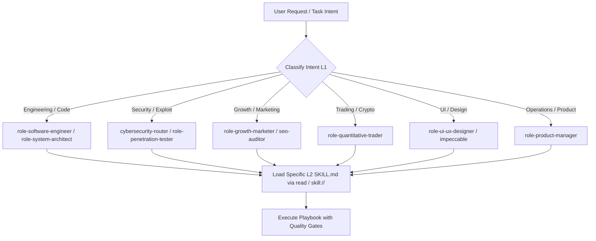

# Skill Router (L1 Master Dispatch)

## Overview

`skill-router` is the master L1 dispatch coordinator for the 1,413+ skills in the `1ai-skills` library. Rather than flatly injecting all skills into an agent's system prompt—which burns ~75k tokens, degrades model attention, and increases trigger collision rates—`skill-router` enforces a two-tier hierarchical dispatch architecture:

1. **Tier 1 (L1 Master Classification):** Maps the user's intent to one of 19 specialized categories or 14 professional `role-*` entry anchors using lightweight heuristic and trigger matching (<1k tokens).
2. **Tier 2 (L2 On-Demand Specialists):** The agent loads only the specific domain playbook (`skill://<name>` or `read ~/.agents/skills/<name>/SKILL.md`) needed for the task at hand.

This matches the ECC (Enterprise Context Control) two-tier pattern: separating daily harness instructions (`DAILY`) from specialized reference playbooks (`LIBRARY`).

## When to Use

**Trigger phrases:**
- "skill router"
- "route skill"
- "find skill"
- "load skill"
- "discover skills"
- "which skill to use"
- "category router"

Use this skill when:
- Starting a complex or cross-functional project where the exact specialized playbook is unknown.
- The user query could span multiple domains (e.g. "audit our checkout page" involves frontend UI, payment rails, and API security).
- Finding the highest-leverage specialist skill without loading hundreds of prompt instructions into context.
- Programmatically querying the skill catalog via `scripts/skill_router.py`.

## When NOT to Use

- When the exact specialized skill name is already known (e.g., `git-workflow-mastery`, `stripe-integration`) — load that skill directly.
- For narrow cybersecurity attacks where the attack surface is already confirmed — use `cybersecurity/cybersecurity-router` directly.
- For routing LLM model endpoints/providers at runtime — use `core/model-router`.
- For Cloudflare edge routing, CDN, and DNS rules — use `core/cloudflare-router`.

## Anti-Rationalization Table

| Rationalization | Reality |
|---|---|
| "I should dump all 1,400 skills into the prompt so the model knows everything." | 1,400 flat skills consume ~75k tokens. Accuracy drops below 65% due to needle-in-haystack attention dilution and prefix collisions (`gate-*`, `p2p-*`). |
| "I don't need a router; I can guess the skill name." | Guessing creates nonexistent skills or misses deep canonical implementations (e.g., guessing `xss-finder` misses `testing-for-xss-vulnerabilities`). |
| "I'll read all SKILL.md files in the repo to pick one." | Reading directory trees blows agent turn context. The router lookup requires a single tokenized scoring pass. |
| "All categories are the same." | The 19 categories have distinct blast radiuses, compliance requirements, and validation gates. Security skills require strict scope proof; trading skills require risk bounds. |

## Workflow



### 1. Intent Classification Matrix (19 Categories & Anchors)

| Category | Skill Count | L1 Anchor Skill | Primary Intent / Vector |
|---|---:|---|---|
| **cybersecurity** | 801 | `cybersecurity-router` / `role-penetration-tester` | Pen-testing, threat hunting, forensics, SOC, cloud & API security |
| **content** | 103 | `role-ui-ux-designer` / `impeccable` / `hallmark` | UI/UX design, typography, writing, video rendering, anti-slop |
| **development** | 103 | `role-software-engineer` / `role-system-architect` | TDD, debugging, refactoring, code review, backend & frontend patterns |
| **mindset** | 55 | `mental-models` / `first-principles-thinking` | Decision frameworks, negotiation, leadership, root-cause analysis |
| **core** | 49 | `model-router` / `skill-router` | AI infrastructure, LLM routing, memory, agent self-improvement |
| **marketing** | 43 | `role-growth-marketer` / `ai-seo` / `seo-auditor` | SEO, GEO/AEO, cold email, paid ads, viral content, analytics |
| **research** | 38 | `role-research-analyst` / `market-research` | Deep research, competitive analysis, trend synthesis |
| **devops** | 32 | `role-devops-sre-engineer` | Docker, Kubernetes, CI/CD pipelines, GitOps, cloud ops |
| **integrations** | 29 | `stripe-integration` / `github` / `discord` | Third-party APIs, SaaS platforms, database connectors |
| **trading** | 27 | `role-quantitative-trader` / `crypto-trading-bot` | Crypto CEX/DEX, Polymarket, funding arbitrage, risk management |
| **automation** | 21 | `nocode-orchestrator` / `task-scheduler` | Web scraping, n8n, workflows, multi-platform bots |
| **operations** | 20 | `role-product-manager` / `project-management` | SOPs, incident command, PRD, business workflows |
| **financial** | 19 | `role-financial-analyst` | Cashflow modeling, DCF valuation, GL reconciliation, CFO ops |
| **mcp** | 15 | `mcp-server-builder` / `mcp-client` | Model Context Protocol servers, toolchain integration |
| **agents** | 14 | `planning-agent` / `autonomous` / `test-agent` | Autonomous multi-agent pipelines, specialized agent roles |
| **meta** | 13 | `auto-learner` / `continuous-learning` | Skill creation, performance monitoring, auto-evolution |
| **sales** | 13 | `b2b-sales-automation` / `high-ticket-closing` | B2B lead generation, outreach pipelines, closing frameworks |
| **productivity** | 10 | `personal-productivity` / `focus-time-management` | Time blocking, calendar management, inbox zero |
| **data** | 8 | `role-data-engineer` | Data pipelines, dbt, Spark, query optimization, ETL |

### 2. Programmatic Discovery via CLI

To find the top 5 matching skills without reading files:

```bash
python3 scripts/skill_router.py "audit web application authentication and session security"
```

*Example Output:*
```text
Score  Category         Name                                 Description
-----------------------------------------------------------------------------------------
 95.0  cybersecurity    auth-killer                          Use for OAuth SAML JWT SSO...
 72.0  cybersecurity    testing-api-authentication-weakness  Test API authentication for...
 65.0  cybersecurity    cybersecurity-router                 Use when starting any cyber...
```

### 3. Execution Protocol

1. **Query & Score**: Tokenize the user's task requirement and match against category and trigger indices.
2. **Select Anchor**: If broad, initialize the relevant `role-*` or `*-router` skill.
3. **Drill Down**: From the anchor's deterministic dispatch matrix, read only the exact specialist `SKILL.md`.
4. **Execute & Verify**: Apply the specialized playbook's anti-rationalization table and verification gates.

## Phase 4: External Discovery Fallback

When the local router returns a top score **below 30**, no specialist skill is a strong match. Rather than hallucinating or failing, delegate to `find-skills` (core/find-skills or meta/find-skills) to acquire a verified community skill.

### Delegation Protocol

1. **Score Threshold Check**: `should_delegate_external(results)` returns `True` when `results[0].score < 30` or `results` is empty.
2. **Probe Registry**: Invoke `find-skills` with the user's original query tokens. Prefer verified registries (skills.sh, ECC, own-repo).
3. **Validate**: Run `scripts/lint-skills.py --write`, `scripts/check-broken-links.py`, and `scripts/test-skills.py --quick` on the downloaded skill.
4. **Import**: Copy the validated skill into `./skills/<name>/` with provenance metadata in frontmatter (`provenance.source`, `provenance.imported_at`).
5. **Index**: `python3 scripts/lint-skills.py --write` updates `SKILLS.json`.
6. **Sync Mirror**: `bash scripts/sync-skills.sh` populates `~/.agents/skills/<name>/`.
7. **Re-Dispatch**: Re-score the query; the imported skill now appears with its trigger bonus (+15 per token) and should clear the 30-point floor.

### Guardrails

- **Never auto-import without user confirmation.** External skills execute code and inject prompts; the user must approve before import.
- Refuse import if skill has >3 unresolved links, no `## When to Use`, or no `## Verification` section.
- All imported skills MUST pass the full validation ladder (`lint-skills`, `check-broken-links`, `validate-skills`, `test-skills --quick`).
- Append `(downloaded: <source>, <date>)` to the skill's description for provenance.
- Default max 3 imports per delegation to prevent dependency sprawl.

### Communication Contract

Pass to `find-skills`:
- `query_tokens`: token set from user request
- `requested_capabilities`: required tools/outputs inferred from query
- `max_imports`: default 3
- `source_preference`: `"verified"` (curated registries) or `"exploratory"` (github raw)

Expect back:
- `skill_name`, `skill_path`, `trigger_phrases`, `tools_provided`, `auth_requirements`

## Verification

- [ ] Query matches route to the expected category anchor (e.g., SEO query → `marketing` / `ai-seo`)
- [ ] No more than 1 anchor skill loaded initially (zero context bloat)
- [ ] Target specialist skill exists on disk and resolves via `read` or `skill://`
- [ ] Router CLI (`scripts/skill_router.py`) executes without syntax or import errors
- [ ] Anti-rationalization table consulted before defaulting to brute-force context loading
- [ ] Phase 4 delegation triggered only when top score < 30 AND user confirms import
