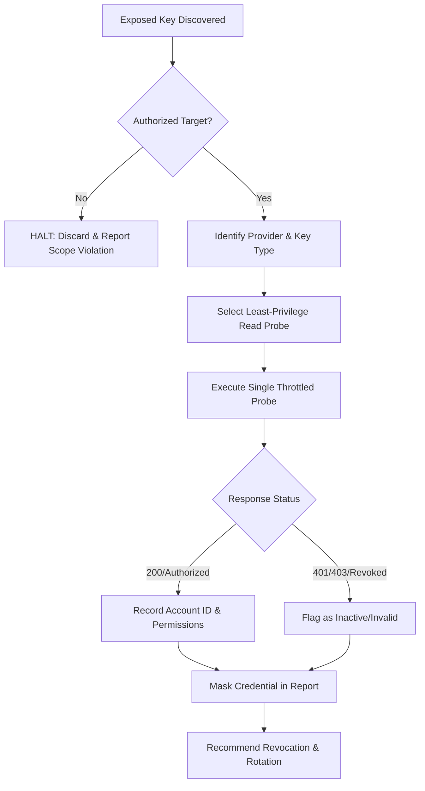

# API Key Leak Validation

## Overview

API Key Leak Validation provides a disciplined, non-destructive methodology for testing whether credentials exposed in public source code, client-side bundles, git histories, or breach dumps are live. Based on KeyHacks patterns, this playbook standardizes safe, read-only authentication probes across major cloud, SaaS, and API platforms while enforcing authorization boundaries, rate limiting, and output masking to prevent collateral compromise or data exfiltration.

## When to Use

**Trigger phrases:**
- "api key validation"
- "validate leaked api key"
- "test exposed credentials"
- "check secret validity"
- "verify leaked token"
- "keyhacks probe"

Use this playbook when:
- Triaging findings from TruffleHog, Gitleaks, or secret-scanning alerts.
- Performing authorized bug bounty reconnaissance where credential leakage is in scope.
- Assessing blast radius and account identity for exposed credentials during security assessments.
- Validating whether reported secrets are active before filing vulnerability tickets.

## When NOT to Use

- **NEVER on out-of-scope targets** or systems where you lack explicit written authorization.
- **NEVER execute state-modifying actions** (POST/PUT/DELETE, resource provisioning, transfers, password resets).
- **NEVER bulk-download or exfiltrate sensitive data** (PII, customer databases, credit cards, proprietary code).
- **NEVER use active probes when passive verification suffices** (e.g., regex pattern matching, checksum validation).
- When a dedicated cloud audit tool (e.g., AWS Pacu, ScoutSuite) is already orchestrating authorized evaluation.

## Anti-Rationalization Table

| Rationalization | Reality |
|---|---|
| "I need to download data to prove the key has read permissions." | An identity or permission probe (`sts:GetCallerIdentity`, `GET /user`, `GET /auth.test`) proves validity without data exfiltration. Reading sensitive rows violates scope and increases legal liability. |
| "I'll just try writing a temporary test record." | Modifying data can disrupt production workloads, trigger billing charges, or corrupt databases. Always use strictly read-only, non-mutating endpoints. |
| "It's in a public repo, so it's fair game to test." | Public exposure does not equal authorization. Only test keys belonging to organizations whose bounty policy or engagement letter covers credential triage. |
| "I don't need to mask the token in logs and tickets." | Pasting raw credentials into issue trackers or terminal logs creates secondary leaks. Mask tokens (e.g., `ak_live_...9f2a`) in all deliverables. |
| "Firing 50 rapid test requests is harmless." | Automated credential sprays trip rate limiters, trigger defensive lockouts, or incur vendor API overage fees. Throttle requests to 1 req/sec maximum. |

## Process



### 1. Pre-Execution Scope & Safety Check
Verify the key belongs to an in-scope asset. Confirm that the verification probe requires no write operations, avoids data dumps, and routes through an approved proxy or test harness.

### 2. Provider-Specific Read-Only Probes

#### Cloud & Infrastructure

##### AWS (Access Key ID + Secret Access Key)
```bash
# Non-mutating identity check; does not access S3, EC2, or IAM policies
export AWS_ACCESS_KEY_ID="AKIA..."
export AWS_SECRET_ACCESS_KEY="..."
aws sts get-caller-identity --output json
```
*Valid response:* JSON containing `UserId`, `Account`, and `Arn`.

##### Google Cloud Platform (API Key)
```bash
# Verify Google Maps / GCP API key permissions safely via tokeninfo or geocoding self-check
curl -s "https://www.googleapis.com/geolocation/v1/geolocate?key=AIzaSy..." \
  -H "Content-Type: application/json" -d '{}'
```

##### Cloudflare (API Token)
```bash
# Read-only token verification endpoint
curl -s -X GET "https://api.cloudflare.com/client/v4/user/tokens/verify" \
  -H "Authorization: Bearer <CLOUDFLARE_API_TOKEN>"
```
*Valid response:* `{"result":{"id":"...","status":"active"},"success":true}`

#### Developer & Code Platforms

##### GitHub (Personal Access Token / Fine-Grained Token)
```bash
# Test authentication and inspect granted scopes without touching repo data
curl -s -i -H "Authorization: Bearer <GITHUB_TOKEN>" \
  "https://api.github.com/user" | grep -E "^(HTTP/|X-OAuth-Scopes:)"
```
*Valid response:* `HTTP/2 200` with `X-OAuth-Scopes` header detailing permissions.

##### GitLab (Personal Access Token)
```bash
curl -s -H "PRIVATE-TOKEN: <GITLAB_TOKEN>" "https://gitlab.com/api/v4/user"
```

##### NPM (Auth Token)
```bash
npm whoami --registry https://registry.npmjs.org/ --//registry.npmjs.org/:_authToken=<NPM_TOKEN>
```

#### Communication & Collaboration

##### Slack (Bot / User Token)
```bash
# Inspect bot identity without reading messages or channel history
curl -s -X POST "https://slack.com/api/auth.test" \
  -H "Authorization: Bearer xoxb-..."
```
*Valid response:* `{"ok":true,"url":"https://...","team":"...","user":"..."}`

##### Slack (Incoming Webhook)
```bash
# Empty payload triggers format validation without posting a public channel alert
curl -s -X POST -H "Content-type: application/json" -d '{"text":""}' \
  "https://hooks.slack.com/services/T.../B.../X..."
```
*Valid response:* `missing_text_or_fallback_or_attachments` confirms the webhook URL is alive.

##### Telegram (Bot Token)
```bash
curl -s "https://api.telegram.org/bot<BOT_TOKEN>/getMe"
```
*Valid response:* `{"ok":true,"result":{"id":...,"is_bot":true,"username":"..."}}`

##### Twilio (Account SID + Auth Token)
```bash
# Check account status without sending SMS or making calls
curl -s -X GET "https://api.twilio.com/2010-04-01/Accounts/<ACCOUNT_SID>.json" \
  -u "<ACCOUNT_SID>:<AUTH_TOKEN>"
```

#### Email & Marketing

##### SendGrid (API Key)
```bash
# Probe scope list; does not send emails or read contact lists
curl -s -X GET "https://api.sendgrid.com/v3/scopes" \
  -H "Authorization: Bearer SG...."
```
*Valid response:* `{"scopes":["..."]}`

##### Mailgun (API Key)
```bash
curl -s -u "api:<API_KEY>" "https://api.mailgun.net/v3/domains"
```

#### Payment Gateways

##### Stripe (Secret Key / Restricted Key)
```bash
# Check key capabilities without charging or retrieving full customer tables
curl -s -u "sk_live_...:" "https://api.stripe.com/v1/balance"
```
*Valid response:* `{"object":"balance",...}`

#### AI & Analytics

##### OpenAI (API Key)
```bash
# Lists available models without generating completions or incurring billing charges
curl -s "https://api.openai.com/v1/models" \
  -H "Authorization: Bearer sk-..."
```

##### Datadog (API Key + Application Key)
```bash
curl -s -X GET "https://api.datadoghq.com/api/v1/validate" \
  -H "DD-API-KEY: <DATADOG_API_KEY>"
```
*Valid response:* `{"valid":true}`

### 3. Automated Validation Script (Python)

Save as `scripts/validate_key.py`:

```python
#!/usr/bin/env python3
"""
validate_key.py — Safe, non-destructive API key validation probe.
Validates key liveness using least-privilege identity endpoints.
"""
import sys
import json
import urllib.request
import urllib.error

PROVIDERS = {
    "github": {
        "url": "https://api.github.com/user",
        "headers": lambda k: {"Authorization": f"Bearer {k}", "User-Agent": "KeyAudit/1.0"}
    },
    "slack": {
        "url": "https://slack.com/api/auth.test",
        "headers": lambda k: {"Authorization": f"Bearer {k}"}
    },
    "openai": {
        "url": "https://api.openai.com/v1/models",
        "headers": lambda k: {"Authorization": f"Bearer {k}"}
    },
    "cloudflare": {
        "url": "https://api.cloudflare.com/client/v4/user/tokens/verify",
        "headers": lambda k: {"Authorization": f"Bearer {k}"}
    }
}

def mask(key: str) -> str:
    if len(key) <= 8:
        return "***"
    return f"{key[:4]}...{key[-4:]}"

def test_key(provider: str, key: str) -> dict:
    if provider not in PROVIDERS:
        return {"error": f"Unsupported provider: {provider}"}
    
    cfg = PROVIDERS[provider]
    req = urllib.request.Request(cfg["url"], headers=cfg["headers"](key))
    try:
        with urllib.request.urlopen(req, timeout=10) as resp:
            data = resp.read().decode("utf-8")
            return {
                "provider": provider,
                "masked_key": mask(key),
                "status": "VALID",
                "http_code": resp.status
            }
    except urllib.error.HTTPError as e:
        return {
            "provider": provider,
            "masked_key": mask(key),
            "status": "REVOKED_OR_FORBIDDEN" if e.code in (401, 403) else f"HTTP_{e.code}",
            "http_code": e.code
        }
    except Exception as e:
        return {"provider": provider, "status": "ERROR", "message": str(e)}

if __name__ == "__main__":
    if len(sys.argv) < 3:
        print("Usage: python3 validate_key.py <provider> <token>")
        sys.exit(1)
    res = test_key(sys.argv[1].lower(), sys.argv[2])
    print(json.dumps(res, indent=2))
```

## Verification

- [ ] Target key belongs to an entity within approved assessment scope
- [ ] Verification command uses a read-only endpoint (no write or state modification)
- [ ] No customer PII, database tables, or proprietary data exfiltrated
- [ ] Key is masked in terminal history, logs, and vulnerability ticket text
- [ ] Remediation report includes key owner, identified permissions, and immediate revocation steps
