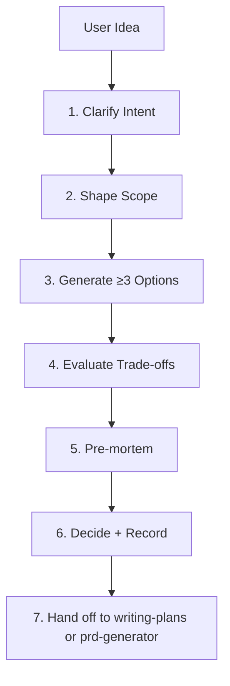

# Brainstorming: From Vague Idea to Shaped Spec

## Overview

Brainstorming is the disciplined pre-build phase: turn a vague idea into a written, reviewed, scoped spec before any code. It is not unstructured ideation — it is a finite, time-boxed process that ends with a decision record and a named next step (usually `writing-plans` or `prd-generator`).

The core principle: **brainstorming ends with a decision, not a list of ideas.** If the session ends with more open questions than it started with, it failed.

## When to Use

**Trigger phrases:**
- "brainstorm", "brainstorming", "ideate"
- "explore options", "shape feature", "design decision"
- "clarify intent", "scope feature", "pre-mortem"

Use when:
- The ask is ambiguous, multi-option, or touches architecture.
- Requirements are implied, not stated.
- Multiple stakeholders disagree on direction.
- You are about to invest >1 day of work and want the approach locked first.

## When NOT to Use

- Trivial, single-file tasks — just do them.
- When requirements are already a written spec with acceptance criteria — go to `writing-plans`.
- When the user wants a single answer, not exploration — state the recommendation directly.
- Pure research with no decision at the end — use `role-research-analyst`.

## Anti-Rationalization Table

| Rationalization | Reality |
|---|---|
| "I already know the best approach" | The first solution is rarely the best. Generate at least 3 options; if you can't, you don't understand the problem yet. |
| "The user wants speed, skip the questions" | Skipping clarification produces rework. 5 minutes of questions saves hours of wrong-direction work. |
| "All options are basically the same" | Then you haven't found the real axis of variation. Probe constraints: cost, latency, reversibility, ownership. |
| "We'll figure out the details during implementation" | Unwritten assumptions become bugs. Write the decision record before code. |
| "The obvious option is obviously right" | Run a pre-mortem anyway. The obvious option has the most hidden failure modes. |
| "Brainstorming is just talking" | Talking without a written artifact is unbounded. End with a written decision record or the session didn't happen. |

## Workflow



### Phase 1: Clarify Intent (5–10 min)

Ask questions one at a time, prefer multiple-choice. Stop when you can state the user's goal in one sentence without hedging.

**Required probes:**
1. **Goal** — What outcome does this produce? For whom?
2. **Success criteria** — How will we know it worked? (measurable)
3. **Constraints** — Budget, deadline, tech stack, team size, compliance.
4. **Out of scope** — What are we explicitly NOT doing?
5. **Existing state** — What exists today? What's broken?

**Probe pattern:**
```text
"I understand the goal as: <X>. Three questions before we proceed:
1. <specific choice A/B/C>
2. <specific choice>
3. <specific choice>"
```

If the user says "just pick", state your assumption explicitly and proceed — do not silently decide.

### Phase 2: Shape Scope (5 min)

Define the boundary of the solution:

| Dimension | In Scope | Out of Scope |
|---|---|---|
| **Users** | Who uses this | Who doesn't |
| **Data** | What data flows | What stays untouched |
| **Systems** | What services touched | What's read-only |
| **Time** | What ships now | What ships later |
| **Risk** | What's reversible | What's one-way door |

**One-way doors** (irreversible decisions: schema changes, public API, data migrations, vendor lock-in) get a separate section in the decision record with rollback plan.

### Phase 3: Generate Options (10 min)

Produce **at least 3 distinct options**. Each option must differ on a real axis (not "same thing, more code"). Required fields per option:

| Field | Content |
|---|---|
| **Name** | Short label (e.g. "Option A: Event-driven pipeline") |
| **Summary** | 2–3 sentence description |
| **Pros** | 2–4 concrete advantages |
| **Cons** | 2–4 concrete disadvantages |
| **Cost** | Effort estimate (hours/days) |
| **Risk** | What breaks if we're wrong |
| **Reversibility** | Easy / Moderate / Hard |

**Axes of variation to probe:**
- Build vs buy vs open-source
- Synchronous vs async
- Monolith vs service
- Cheap now vs cheap at scale
- Single-tenant vs multi-tenant

### Phase 4: Evaluate Trade-offs (5 min)

Build a comparison matrix. Score each option against the constraints from Phase 1:

```markdown
| Criterion (weight) | Option A | Option B | Option C |
|---|---|---|---|
| Fits deadline (30%) | 5 | 3 | 4 |
| Reversibility (20%) | 4 | 2 | 5 |
| Cost (20%) | 3 | 5 | 3 |
| Team fit (15%) | 4 | 4 | 3 |
| Risk (15%) | 3 | 4 | 4 |
| **Weighted** | **3.95** | **3.65** | **3.85** |
```

Weights come from the user's stated priorities, not yours. If the user won't weight, default: feasibility 40%, impact 30%, cost 20%, reversibility 10%.

### Phase 5: Pre-mortem (5 min)

Assume the chosen option shipped and failed 6 months later. Write 3–5 failure scenarios:

```markdown
## Pre-mortem: Option A failed because...
1. <specific failure mode and its trigger>
2. <specific failure mode>
3. <specific failure mode>
```

Then for each: is there a mitigation in the chosen design? If not, either add it or reject the option.

### Phase 6: Decide + Record (5 min)

Write the decision record. It must be short, concrete, and actionable:

```markdown
# Decision Record: <Feature/Problem>

**Date:** YYYY-MM-DD
**Decision:** Option A — <name>

## Goal
<one sentence>

## Constraints
- <list>

## Options Considered
- Option A: <summary> (chosen)
- Option B: <summary> (rejected because <reason>)
- Option C: <summary> (rejected because <reason>)

## Decision Rationale
<2-3 sentences: why this option wins on the weighted criteria>

## One-way Doors
- <irreversible decisions + rollback plan>

## Pre-mortem Mitigations
- <failure mode> → <mitigation>

## Open Questions
- <anything deferred to implementation>

## Next Step
- `writing-plans` to produce implementation plan, or `prd-generator` for spec.
```

### Phase 7: Hand off

Pass the decision record to `writing-plans` (implementation plan) or `prd-generator` (spec). Do not start coding from a brainstorming output — always convert to a plan first.

## Frameworks (Reference)

- **5 Whys** — root cause of "why are we building this"
- **Jobs-to-Be-Done** — what job is the user hiring this for
- **MoSCoW** — Must / Should / Could / Won't for scope shaping
- **Build vs Buy vs Open Source** — for tool/service decisions
- **Architecture Decision Records (ADR)** — for one-way doors

## Verification

- [ ] Intent clarified to a single unambiguous goal sentence
- [ ] At least 3 distinct options generated with pros, cons, cost, risk, reversibility
- [ ] Comparison matrix scored against weighted constraints
- [ ] Pre-mortem written with ≥3 failure scenarios and mitigations
- [ ] Decision record written with chosen option, rejected reasons, one-way doors, next step
- [ ] Hand-off to `writing-plans` or `prd-generator` initiated (no direct coding)

## Anti-Rationalization Table (Extended)

| Rationalization | Reality |
|---|---|
| "We already discussed this in Slack" | Slack threads decay. A written decision record in the repo is the source of truth. |
| "The constraints are obvious" | Obvious constraints are the ones that get violated. Write them down. |
| "One option is clearly dominant" | Dominant on which axis? Reversibility and risk often flip the ranking. Score them. |
| "We'll A/B test later" | A/B testing is not a substitute for a decision. Decide now, test the decision. |
| "The user is the expert, just do what they say" | The user knows the problem; you know the solution space. Both inputs required. |

## Related Skills

- `writing-plans` — converts decision record to implementation plan
- `prd-generator` — converts decision record to product spec
- `role-product-manager` — owns product direction; brainstorming feeds into it
- `decision-frameworks` — structured decision-making for high-stakes choices
- `change-impact-analysis` — blast-radius check before touching code